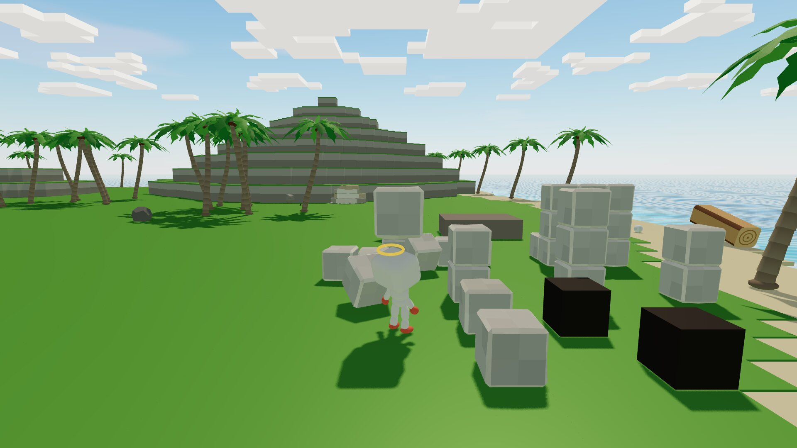
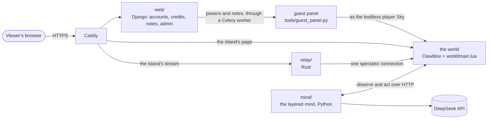
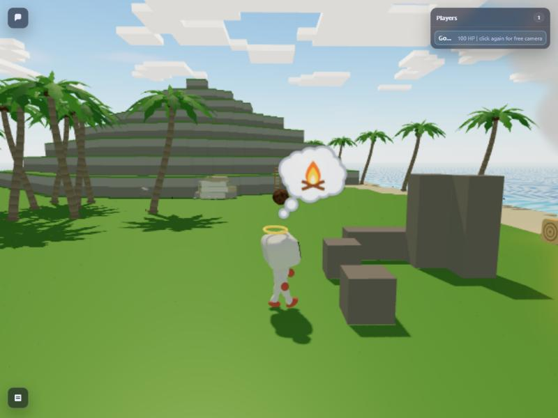

# Godling

**An AI that lives alone on an island and learns to build.**

Godling is a small castaway in a 3D physics world, driven by a language model. It walks, quarries stone, fells
palms, climbs ladders, makes fire by friction and builds houses, and it teaches itself skills as it goes. It says
what it intends and what it is short of, and a thought bubble shows what is on its mind.

It was built as a live show that runs day and night. Viewers watch in the browser, send it notes, and spend credits
to change its world: a stone or a log from the sky, a storm, a meteor, an earthquake. They can never buy its
decisions.



> **Status: archived.** Godling ran in November 2026 and is no longer running. This is the code as it was when it
> stopped. It is not maintained.

## How it works



### The mind (`mind/`)
Think about the past and the future; don't think about walking. The first runs had a coding agent drive the world
directly: on Claude Opus it made about two full model calls per world action, spent 45% of its time waiting for the
model, and cost about $24 an hour. Godling's mind splits the work into layers instead ([`research/layered-mind-design.md`](research/layered-mind-design.md)):

- **L3, the mind** (`godling/mind.py`): an LLM chooses the next project, narrates its intention, writes lessons,
  defines new skills from the body's moves, and sleeps every hour to consolidate its memory.
- **L2, attention** (`godling/attention.py`): notices new objects, damage to what it kept, visitors and sky events,
  and interrupts a plan only for the salient ones.
- **L1, the body** (`godling/skills.py`): moves that know reach, overlap and the way round rocks and trees, but no
  strategy (`walk_to`, `pick_up`, `put_down`, `place_at`, `throw`, `jump`, `say`, `wait`), and reflexes that run
  without the mind: a glance at what attention noticed, bracing in an earthquake, taking shelter when cold and hurt.
- **Learned skills** (`godling/learned.py`): skills the mind writes as steps. They count only once they have worked
  in the world, and keep their steps while they keep working (ADR-032).
- **Memory** (`godling/memory.py`): episodes, intentions, the structures it keeps and a digest, behind one interface.
  Three engines were compared: `native`, `native2` and [Hindsight](https://github.com/vectorize-io/hindsight)
  (ADR-002, ADR-005).
- **Voice** (`godling/speech.py`): what it says aloud, in plain words, and a few lines of its own at the moments
  viewers care about: its death and rebirth, a lost house, a viewer's note (ADR-031).

The body acts while the mind thinks: in the run that tested ADR-009 it was busy 90% of the time, up from 47%. With
DeepSeek's `deepseek-flash` the mind cost about $0.21 an hour. [`mind/README.md`](mind/README.md) has the layers, the flags and the reflexes in
full.

### The world (`world/`)
A Luau script, [`world/main.lua`](world/main.lua), on [Clawblox](https://github.com/nacloos/clawblox): a headless
Rust engine with Rapier physics at 60 Hz. It began as Clawblox's Mesa Island and became a castaway island
(`tools/make_island.py`): beaches, meadows, a stepped rocky peak with a quarry at its foot, palms, the sea that
drowns, weather and a 40-minute day. Building is block-sized: 2.5-unit blocks on a grid, logs as three-block beams, ladders, fastening
like mortar, and one definition of a house shared by the world, the mind and the measure (ADR-019, ADR-033).
Viewers' powers come in through a bodiless player, `Sky`. [`world/README.md`](world/README.md) lists every change
from upstream; `patches/` holds the five changes made to Clawblox itself (a sandbox fix, an offline viewer, a private
agent API, a reconnecting stream, dependency updates).

### What viewers see (`world/renderer/`, `world/viewer/`)
A three.js renderer rebuilt for phones, with quality tiers and no CDN (ADR-006). Over it, the viewers' screen: a
block-game HUD ([`DESIGN.md`](DESIGN.md)) with the powers, notes, what Godling thinks and needs, a feed of what
viewers did, and replay with time travel: each viewer's own timeline at 1× to 16×, markers and shared links (ADR-016).



### The site (`web/`)
A Django site in front of the screen ([`web/README.md`](web/README.md)): the front page, a game booklet about
Godling; accounts with django-allauth, email confirmation and two-factor sign-in for staff; credits through Stripe
Checkout, with refunds and disputes taking credits back; notes with reports and moderation; the admin. Powers reach
the island through a Celery worker, so no web request waits on the world (ADR-014). The site refuses live Stripe keys
until an outside security review is named ([`deploy/security-review.md`](deploy/security-review.md)).

### The stream relay (`relay/`)
One connection to the world's spectator stream, the same updates to every viewer: gathered to ten a second, gzipped
once for everyone, resumable after a gap, with limits per address (ADR-015, [`relay/README.md`](relay/README.md)).

### Running it on a server (`deploy/`)
Docker Compose on one machine: Postgres, Redis, the site and two Celery workers, the island (world, mind and panel),
the relay, Caddy for HTTPS, Prometheus with Alertmanager, and encrypted restic backups to an S3-compatible bucket
(ADR-017, ADR-018). It ran on one Arm server behind Cloudflare. [`deploy/README.md`](deploy/README.md) sets it up;
[`deploy/RUNBOOK.md`](deploy/RUNBOOK.md) is how it was operated.

## Repository layout

| Path | What is in it |
|---|---|
| [`mind/`](mind/) | The layered mind, its persona, the launcher `run_godling.py`, and its tests |
| [`world/`](world/) | The world script `main.lua`, the island, the models (`assets/`), the renderer, the viewers' screen and its prototypes, and the world script's tests |
| [`web/`](web/) | The Django site: accounts, credits, notes, feedback, rules and the screen |
| [`relay/`](relay/) | The stream relay, in Rust |
| [`deploy/`](deploy/) | Dockerfiles, Compose, Caddy, monitoring, backups, the outside check (`check.sh`) and the runbook |
| [`tools/`](tools/) | The guest panel, the island generator, long-run launchers and run analysis |
| [`art/`](art/) | Blender build scripts for Godling and the props, and their previews (Godling's Mixamo animations are downloaded separately: [`art/README.md`](art/README.md), *Sources*) |
| [`patches/`](patches/) | The changes to Clawblox, each with its write-up |
| [`decisions/`](decisions/) | The decision records, ADR-002 to ADR-033 |
| [`research/`](research/), [`reports/`](reports/), [`research_notes/`](research_notes/) | Design notes, screenshots, and research on god games and agent minds |
| [`PRODUCT.md`](PRODUCT.md), [`DESIGN.md`](DESIGN.md) | What the product was for, and the screen's design system |
| [`TESTING.md`](TESTING.md) | The tests |
| [`.github/`](.github/) | CI: the tests, config checks, a weekly dependency audit, and Dependabot |

## Running it

You need:
- Linux, or WSL2 on Windows (it was built on Ubuntu 22.04 under WSL);
- Rust and Cargo, to build Clawblox and the relay;
- Chromium, for Godling's eyes: the world renders what it sees with the same renderer in headless Chromium;
- Python 3.10 or newer for the mind (standard library only), and 3.12 or newer for the site;
- Node.js only to rebuild or test the renderer: the built bundle is committed;
- a [DeepSeek API key](https://platform.deepseek.com/).

1. **Clawblox**, at the commit the world was made for, with the five patches applied in order, installed to
   `~/.cargo/bin` (or point `CLAWBLOX_BIN` at another build):
   ```bash
   git clone https://github.com/nacloos/clawblox ~/clawblox && cd ~/clawblox && git checkout 8be90a0
   for p in v0-fix-cli-sandbox v1-viewer-terrain-and-offline v2-private-agent-api v3-stream-reconnect v4-dependency-updates; do
     git apply /path/to/godling/patches/$p.patch
   done
   cargo install --path . --locked
   ```
2. **The DeepSeek key:** `export DEEPSEEK_API_KEY=…`, or run `tools/setup_deepseek.sh` once.
3. **A run**, from the repository's root:
   ```bash
   python3 mind/run_godling.py --run-dir ~/godling-runs/first --guest-panel 8081
   ```
   It starts the island on port 8080, prints the spectator link, and joins as Godling, printing what it thinks,
   intends, does, says and learns. http://localhost:8081/ is the guest panel: the live island, Godling's thoughts and
   needs, and the sky powers, free. Ctrl+C stops the mind and the world together. The run folder keeps the logs,
   Godling's memory and learned skills, and the island as it stands (`island-save.json`).

More:
- **Flags:** `--model deepseek-v4-pro` (a stronger mind, about five times the cost), `--memory hindsight`,
  `--relay 8082` (stream through the relay: `cd relay && cargo build --release` first), `--minutes 60`, and the rest
  in [`mind/README.md`](mind/README.md).
- **Afterwards:** `python3 tools/analyze_run.py ~/godling-runs/first` reports the world's numbers, the mind's calls,
  its cost and how its skills did.
- **The site** in development, against a local island: [`web/README.md`](web/README.md), *Running it*.
- **Everything as it was deployed**, with Docker Compose: [`deploy/README.md`](deploy/README.md).

## Tests

Five suites, all run in CI (`.github/workflows/tests.yml`). [`TESTING.md`](TESTING.md) has the details.

| Suite | Command |
|---|---|
| The mind and the tools (pytest) | `python -m pip install pytest coverage zstandard && python -m pytest` |
| The site (Django) | `cd web && python -m pip install -r requirements.txt && python manage.py test` |
| The renderer and the viewers' screen (vitest) | `cd world/renderer && npm ci && npm test` |
| The world script (Luau, in a small Rust runner) | `cargo build --release --manifest-path world/tests/runner/Cargo.toml && world/tests/runner/target/release/luau-test world/tests/test_*.luau` |
| The stream relay | `cd relay && cargo test --locked` |

None of them needs Clawblox or a DeepSeek key: the mind's skills run on a stand-in island, the world script on a
stand-in engine, and the relay against a fake world.

## Decisions

[`decisions/`](decisions/) holds 32 decision records, ADR-002 to ADR-033. Each says what was decided and why, and
most record what the runs measured afterwards. Some to start with:
- [ADR-002](decisions/ADR-002-think-while-moving-and-brain-memory.md): think while moving, and a brain-like memory;
- [ADR-006](decisions/ADR-006-renderer-not-engine.md): keep Clawblox and three.js, and rebuild the renderer for phones;
- [ADR-014](decisions/ADR-014-security-hardening.md): a private agent API, and a site that never waits on the island;
- [ADR-016](decisions/ADR-016-replay-and-time-travel.md): replay and time travel;
- [ADR-017](decisions/ADR-017-public-edge.md): the public edge: limits, Cloudflare, monitoring and audits;
- [ADR-022](decisions/ADR-022-death-and-rebirth.md): death and rebirth, and learning from them;
- [ADR-030](decisions/ADR-030-the-body-acts-while-the-mind-thinks.md): the body acts while the mind thinks.

## Costs and requirements

- **The mind:** a DeepSeek API key. About $0.21 an hour with `deepseek-flash` while the island runs (about $5 a day);
  `deepseek-v4-pro` costs about five times as much. Nothing else spends model credits.
- **The world:** Clawblox (MIT) at commit `8be90a0`, with the patches in `patches/`. Building it needs 4 GB of memory
  or more.
- **As it was hosted:** one Hetzner CAX21 (Arm64, 4 vCPUs, 8 GB) at €12.69 a month, where the island ran at 62
  ticks a second on about 1.5 of the 4 cores; Cloudflare's free plan in front; Cloudflare R2 for replays and backups
  (the first 10 GB a month free; replays grow about 0.2 GB a day); an SMTP provider for email; Stripe's fees per
  payment.

## Status

Archived. Godling ran on its own server in November 2026, and the project ended soon after; nothing runs any more.
The code is left as it was at the end.

## License

[MIT](LICENSE), Copyright (c) 2026 Ozgun Ay, with one exception and one notice:
- **Mixamo animations, not covered by MIT:** Godling's animations in `world/assets/godling.glb` (and
  `art/godling.blend`) were made by `art/build_godling.py` from animations downloaded from Adobe Mixamo. The Mixamo
  files themselves (`art/source/*.fbx`) are no longer in the repository; rebuilding the model means downloading them
  again ([`art/README.md`](art/README.md), *Sources*). Earlier commits still contain them, and those files stay under
  Adobe's terms for Mixamo, not this repository's licence.
- **Clawblox:** `world/` started from Clawblox's `worlds/mesa-island`, and `patches/` change Clawblox. Clawblox is
  also MIT, Copyright (c) 2026 nacloos.

## Acknowledgements

- [Clawblox](https://github.com/nacloos/clawblox) by nacloos: the engine, and the Mesa Island Godling's world grew from.
- [Rapier](https://rapier.rs/) and [Luau](https://luau.org/), inside Clawblox; [three.js](https://threejs.org/) for
  the renderer.
- [DeepSeek](https://www.deepseek.com/), the model behind the mind, and [Hindsight](https://github.com/vectorize-io/hindsight),
  one of its memory engines.
- [Adobe Mixamo](https://www.mixamo.com/), for the animations behind Godling's moves.
- Django, django-allauth, Celery, Stripe, Caddy, restic and Prometheus, on which the site and the deployment stand.
- The research the mind's design leans on (Voyager, Generative Agents, SwiftSage, Talker-Reasoner and others), and
  the god games that shaped the show (Populous, Black & White, Reus, WorldBox and others), collected in
  [`research/`](research/) and [`reports/`](reports/).
